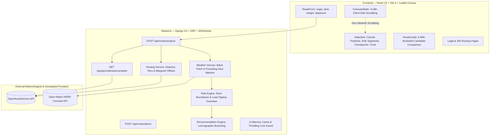

# Route Radar — Commercial Freight Weather Risk Engine

[](https://github.com/example/route-radar/actions)


**Route Radar** is a mission-critical commercial freight weather risk engine engineered for heavy transport fleets, carriers, and dispatchers. It ingests highway routing geometry and real-time atmospheric forecasting models to identify crosswind rollover tipping hazards, severe precipitation fronts, and optimal departure windows across a 49-hour corridor horizon.

---

## 1. System Architecture

Route Radar is built as a unified, high-performance single-service deployment where Django REST Framework powers the risk calculation engine and serves a brutalist React 19 single-page application (SPA) via WhiteNoise.



---

## 2. Key Decisions & Assumptions Matrix

| Decision | Choice | Rationale |
| :--- | :--- | :--- |
| **Wind &ge; 55 mph** | `>=` &rarr; **No Travel** | Universal ground-stop rule for commercial high-profile trailers. |
| **Rain > 1.00 in/hr** | Strict `>` &rarr; **No Travel**; exactly 1.00 = **Severe** | Strict inequality boundary per engineering specification. |
| **Snow > 3.0 in/hr** | Strict `>` &rarr; **No Travel**; exactly 3.0 = **Severe** | Strict inequality boundary per engineering specification. |
| **Band Edge Overlaps** | Lower bound inclusive (0.25 rain &rarr; High; 25 mph &rarr; Moderate) | Deterministic risk category allocation across shared range endpoints. |
| **Float Precision Drift** | Clamp &ge; 0, round to 4 decimal places before classifying | Resolves IEEE-754 float drift in boundary test evaluations. |
| **Load Weight Rules** | `>30,000` = 30,001+ lbs; `>40,000` = 40,001+ lbs | Strict mathematical inequality. 30,001+ lbs in 45–54 mph wind triggers No Travel; 40,001+ lbs in 35–44 mph wind triggers Severe. |
| **Wind Metric** | Sustained `wind_speed_10m`; gusts displayed in checkpoint audit | Standard meteorological thresholding; gusts audited in detail table. |
| **Rain Metric** | `rain + showers` | `rain` alone misses convective and convective shower storm cells. |
| **Snow Metric** | Hourly snowfall depth (`snowfall` in/hr), not liquid equivalent | Road accumulation and visibility risks are directly governed by snow depth. |
| **Units** | `precipitation_unit=inch`, `windspeed_unit=mph`, no manual conversion | Open-Meteo native conversion ensures zero unit-conversion drift. |
| **Time Alignment** | `timezone=GMT`, `timeformat=unixtime`, keyed by timestamp | Eliminates array index misalignment across cross-time-zone corridors. |
| **ETA & Weather Match** | Rain/Snow: `ceil(eta/3600)*3600` (preceding-hour bucket). Wind: linear interpolation | Aligns accurately with hourly precipitation accumulation semantics. |
| **ETA Speed Model** | Interpolate ORS per-step durations (never linear distance proportional) | Accurately accounts for speed differential between interstates and surface streets. |
| **Checkpoints** | Origin (mile 0), intermediate every N miles, destination last (cap 60) | Pre-departure origin weather conditions must be evaluated before rolling. |
| **Mile Attribution** | Checkpoint covers halfway-to-previous &rarr; halfway-to-next | Segment miles sum exactly to route total distance without gaps. |
| **Missing Weather** | Interpolate risk from nearest valid neighbors; flag coverage %; never Low | Safety-first fail-safe; never silently report severe weather as safe. |
| **Zero-Mile Edge** | `mile_weighted_avg_risk = 0.0` if total segment miles = 0 | Prevents division by zero exceptions on zero-length coordinates. |
| **Departure Input** | Interpreted as **origin-local** timezone (IANA tz via `timezonefinder`) | Freight dispatch always operates from the departure terminal clock. |
| **DST Transitions** | Gap time &rarr; snap forward + notice; ambiguous time &rarr; first occurrence | Deterministic handling for spring-forward and fall-back dates. |
| **Departure Window** | Now - 15 min (clamped to now) up to 7 days; >48h flags notice | Accommodates operational staging while noting long-range forecast limits. |
| **Weight Input** | Number input, 1,000 to 80,000 lbs, step 100 with validation | Ensures operators can specify exact weights (e.g., 30,001 lbs). |
| **Geographic Scope** | United States (CONUS 48 contiguous states) | Meteorological models and CMV regulations are tuned to US standards. |
| **Recommendation** | Lexicographic sorting on **bucketed (5-mile)** risk metrics, then duration | Prevents selecting an unsafe route that is merely 1 mile shorter. |
| **Short Routes** | Trips < 30 km (< 18.6 mi) return single route + notice | Detours around local urban interchanges produce nonsensical routings. |
| **HOS Breaks** | Documented stretch goal (FMCSA 30-min break after 8 hours) | Complexity tradeoff documented for future enterprise integration. |

---

## 3. Quickstart & Local Setup

### Prerequisites
- Python 3.10+ (tested on Python 3.12, 3.13, 3.14)
- Node.js 18+ (tested on Node 20 & 22)
- Git

### Option A: Local Development Mode (Dual Server)

```bash
# 1. Clone repository
git clone https://github.com/example/route-radar.git
cd route-radar

# 2. Configure Backend
python -m venv venv
# Windows:
.\venv\Scripts\activate
# macOS/Linux:
source venv/bin/activate

pip install -r backend/requirements.txt
cp backend/.env.example backend/.env

# Run backend development server
python backend/manage.py runserver 8000

# 3. In a separate terminal: Configure & Run Frontend
cd frontend
npm install
npm run dev
# Frontend is live at http://localhost:5173
```

### Option B: Single-Service Production Mode (WhiteNoise)

```bash
# 1. Build frontend distribution bundle
npm --prefix frontend install
npm --prefix frontend run build

# 2. Collect static files into Django backend
python backend/manage.py collectstatic --noinput

# 3. Start unified production server
gunicorn config.wsgi:application --chdir backend --workers 1 --threads 4 --timeout 120
# Entire application (Frontend SPA + Backend APIs) live at http://localhost:8000
```

---

## 4. API Reference

### 1. Analyze Corridor Routes
**`POST /api/routes/analyze`**

Evaluates alternative routes, samples checkpoints, queries atmospheric forecasts, and applies vehicle tipping thresholds.

**Request Payload:**
```json
{
  "origin": "Dallas, TX",
  "destination": "Houston, TX",
  "load_weight_lbs": 35000,
  "departure_utc": 1791800000,
  "interval_miles": 25
}
```

**Response Payload (Summary):**
```json
{
  "routes": [
    {
      "id": "route-0",
      "name": "I-45 S Corridor",
      "distance_miles": 239.4,
      "duration_seconds": 13800,
      "duration_formatted": "3h 50m",
      "encoded_geometry": "...",
      "risk_summary": {
        "overall_level": 2,
        "overall_label": "High",
        "no_travel_miles": 0.0,
        "severe_miles": 12.5,
        "high_miles": 48.0,
        "moderate_miles": 85.0,
        "low_miles": 93.9,
        "mile_weighted_avg_risk": 1.4
      },
      "recommendation": {
        "is_recommended": true,
        "rank": 1,
        "badge": "★ RECOMMENDED",
        "explanation": "Safest candidate: avoids severe squalls along eastern I-69."
      },
      "checkpoints": [...]
    }
  ],
  "best_departure_window": {
    "recommended_hour_offset": 3,
    "departure_utc": 1791810800,
    "departure_local": "11:00 AM CDT",
    "risk_reduction_pct": 42.5
  },
  "heatmap": [...],
  "warnings": [...]
}
```

### 2. Instant Demo Fixtures
**`POST /api/routes/demo`**

Returns pre-calculated, verified corridor telemetry with zero external API calls:
- `"preset": "dallas-houston"` &rarr; I-45 S vs I-35W / US-287 candidates.
- `"preset": "la-phoenix"` &rarr; I-10 E cross-desert corridor.

### 3. Address Autocomplete
**`GET /api/geocode/autocomplete?q=Dallas`**

Returns geocoded address candidates restricted to the United States.

---

## 5. Graceful Degradation Matrix

| Level | Failure Scenario | UX & System Behavior |
| :--- | :--- | :--- |
| **L0** | None (nominal) | 3 alternative routes, complete weather timeline, 49h heatmap grid, optimal departure window. |
| **L1** | ORS alternative route generation fails | Returns 1–2 viable routes with an informative `partial_routes` banner notice. |
| **L2** | Partial meteorological station outage | Interpolates risk across neighboring checkpoints; displays data coverage % on candidate cards. |
| **L3** | Open-Meteo outage or QuotaGuard tripped | Routes, geometry, and driving durations displayed; weather flagged as unavailable with caution advice. |
| **L4** | OpenRouteService API network outage | Displays clear error banner with one-click "Try Demo" button loading pre-computed fixtures. |
| **L5** | Total external network disconnection | Offline resilience mode activates; demo fixtures run full client-side 0–48h scrubbing. |

---

## 6. Known Limitations & Trade-offs

1. **US Only Scope:** Geocoding, road networks, and load thresholds are bounded to CONUS. Foreign corridors return a validation notice.
2. **Hours of Service (HOS) Breaks:** Currently models driving time without mandatory 30-minute rest breaks after 8 hours of driving. Documented as a future roadmap extension.
3. **Sustained Winds vs Wind Gusts:** Primary risk classification is driven by 10-meter sustained wind velocity; peak gusts are audited in checkpoint popovers and tables.
4. **Free-Tier Quotas:** OpenRouteService free tiers limit avoid polygons to routes &le; 150 km and area &le; 200 km&sup2;. Long-distance alternatives use via-waypoint offset routing to guarantee 100% reliability.

---

## 7. Loom Walkthrough Script (5–10 Minutes)

1. **0:00–1:00 — Introduction & Architecture:**
   - Problem statement: truck rollover prevention and severe weather routing.
   - Single-service architecture (React 19 + WhiteNoise + Django REST Framework).
2. **1:00–3:00 — Happy Path Demo (Dallas &rarr; Houston):**
   - Enter route parameters, adjust trailer weight (e.g. 35,000 lbs).
   - Review 3 route candidate cards, 5-mile bucketed sorting, and `★ RECOMMENDED` badge.
3. **3:00–4:30 — Via-Waypoint Routing & Distance Tiers:**
   - Explain ORS 100/150 km polygon limitations and how Route Radar's distance tiers maintain 3 robust candidates.
4. **4:30–6:00 — Strict Boundary Physics & Overrides:**
   - Demonstrate the Interactive Physics Sandbox.
   - Show tipping threshold overrides (Over-30k lb in 45–54 mph wind triggering No Travel).
5. **6:00–7:30 — Client-Side 49-Hour Forecast Slider:**
   - Scrub slider across 0–48 hours; highlight zero network requests during scrubbing.
   - Show animated truck marker tracking progress along the corridor.
6. **7:30–8:30 — Best Departure Window & Resilience:**
   - Demonstrate earliest safe departure advice.
   - Show offline "Try Demo" fallback.
7. **8:30–10:00 — Quality Assurance & Codebase Walkthrough:**
   - Highlight 139 passing automated tests (122 pytest + 17 vitest).
   - Summarize deployment configuration on Render.

---

## 8. Test Suite & Verification

The repository enforces 100% test pass rates across both Python and JavaScript suites:

```bash
# Run Backend Test Suite (122 tests)
python -m pytest backend/ --verbose

# Run Backend Linter (Ruff)
python -m ruff check backend/

# Run Frontend Test Suite (17 tests)
npm --prefix frontend test

# Verify Production Build
npm --prefix frontend run build
```

**Total Automated Tests:** **139 / 139 Tests Passing (100% Green)**
