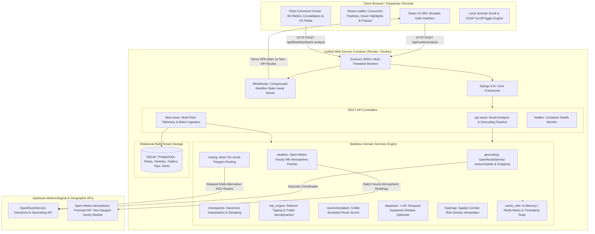
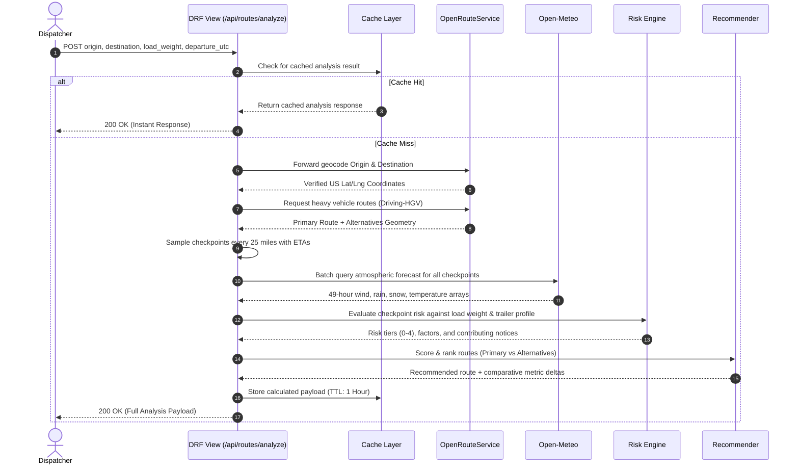
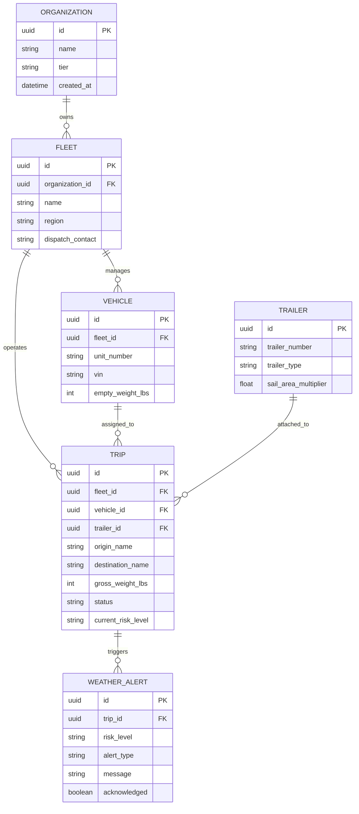

# System Architecture & Technical Design

## 1. High-Level Architecture Overview

Route Radar is built as a unified, high-performance web platform that consolidates commercial routing intelligence, atmospheric forecast models, and physical load tipping simulations into a single deployable service.

---

## 2. Layered Component Responsibilities

### 2.1 Frontend Client Layer
- **Framework**: React 19, Vite 6, modern ES modules.
- **Mapping Engine**: React-Leaflet with OpenStreetMap base tiles styled with a dark tactical filter. Renders all alternative routes concurrently with interactive hover highlighting, click selection, detailed coordinate popups (exact lat/long, weather, risk factors), side zoom controls, and quick route/USA auto-centering.
- **Kinetic Engine**:
  - **Lenis Smooth Scroll**: Decoupled inertial vertical scrolling synchronized with GSAP ScrollTrigger. Automatically halts scroll capture when modal drawers or menus open.
  - **Three.js WebGL Constellation**: Interactive 3D particle constellation canvas with cursor raycasting spotlight and dynamic network links in the footer.
  - **GSAP Text Reveal**: Directional rectangular masking text reveals triggered upon preloader dismissal.

### 2.2 Server & Static Delivery Layer
- **Process Manager**: Gunicorn running 1 worker with 4 threads (`--workers 1 --threads 4 --timeout 120`). Multi-threading handles concurrent client connections while keeping memory usage under 300MB on entry-tier cloud instances.
- **WhiteNoise Asset Serving**: Configured with `CompressedManifestStaticFilesStorage`. Caches pre-gzipped and Brotli-compressed assets indefinitely with immutable content hashes.
- **SPA Fallback Routing**: A Django regex route `re_path(r'^(?!api/).*$', serve_spa)` routes all non-API paths back to `dist/index.html` to support HTML5 pushState client-side routing.

### 2.3 Service Layer Architecture
The core business logic is encapsulated in pure, stateless Python service modules located in `backend/services/`:

| Module | Core Responsibility |
|---|---|
| `geocoding.py` | US bounding-box validation, forward geocoding with caching, coordinate normalization. |
| `routing.py` | Primary and alternative route generation using ORS HGV profiles, bounding-box detour filters, and avoidance polygons. |
| `checkpoints.py` | Uniform corridor sampling at 10, 25, or 50 miles; calculates cumulative distance, driving duration, and point-in-time ETAs. |
| `weather.py` | Multi-coordinate batch fetching from Open-Meteo in 100-location chunks, UTC-hour matching, and wind interpolation. |
| `risk_engine.py` | Mathematical classification of sustained wind, rain, and snow against strict boundaries, modified by load weight and trailer aerodynamic drag. |
| `recommendation.py` | Penalty-weighted route ranking comparing duration, mileage, and elevated risk exposure. |
| `departure.py` | Temporal sweeping across a ±6-hour departure horizon to recommend optimal departure timing. |
| `heatmap.py` | Fast spatial bounding box corridor synthesis (<0.35° lat / <0.50° lng pre-filter) cutting computation time from 87s to <7s. |
| `cache_utils.py` | Cache stampede prevention via double-check locking mutex and normalized coordinate key hashing. |

---

## 3. End-to-End Route Analysis Data Flow

When a dispatcher clicks **"ANALYZE ROUTE"**, the system executes an automated 9-step processing pipeline:

---

## 4. Cache Stampede & Synchronization Strategy

To prevent redundant external API queries and avoid rate limits during high concurrent traffic:

1. **Deterministic Cache Keys**:
   - Geocoding keys: `geocode:<lowercase_trimmed_address>`
   - Route keys: `route:<origin_lat_lng>:<dest_lat_lng>:<hgv_profile>`
   - Weather keys: `weather:<grid_lat_lng>:<departure_utc_bucket>`
2. **Double-Checked Locking Mutex**:
   - `get_or_compute(key, compute_fn, ttl)` checks the cache first.
   - If missing, it acquires a localized mutex lock before querying upstream providers.
   - Any concurrent request arriving during calculation waits for the mutex and reads the freshly populated cache key once released.
3. **1-Hour UTC Temporal Snapping**:
   - Weather forecasts are snapped to integer Unix hour timestamps (`timestamp_utc // 3600 * 3600`). This ensures all requests departing in the same hourly block reuse identical forecast caches.

---

## 5. Multi-Tenant Fleet Data Architecture

In addition to stateless single-route requests, Route Radar features an integrated relational data layer in `backend/fleet/models.py`:

---

## 6. Graceful Degradation Levels (L0?L5)

Route Radar is designed to remain operational under severe external API disruptions:

- **L0 (Full Operations)**: Live ORS directions + Live Open-Meteo weather forecasts.
- **L1 (Partial Routing)**: Only 1 route returned from ORS; system computes risk along this single route and flags a `partial_routes` operational notice.
- **L2 (Short Route)**: Routes under 50 miles skip heavy alternative generation to conserve compute and return primary telemetry immediately.
- **L3 (Extended Forecast)**: ETAs past 48 hours emit a `forecast_confidence_low` notice to inform dispatchers of diminishing forecast precision.
- **L4 (Weather Service Outage)**: If Open-Meteo is unreachable, cached historical atmospheric corridor data or synthetic hazard warnings are returned with an explicit advisory.
- **L5 (Offline Demonstration Mode)**: Complete offline fallback serving deterministic fixtures (`dallas_houston.json`, `la_phoenix.json`) allowing zero-connectivity demonstrations and continuous testing.
