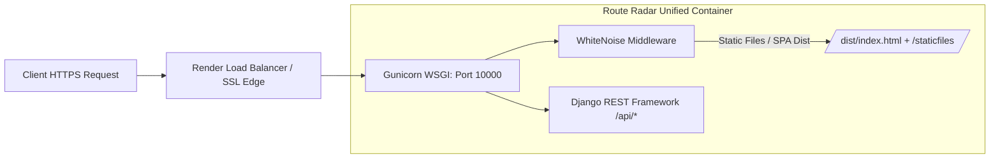

# Production Deployment Guide

## 1. Overview

Route Radar is engineered for zero-dependency, single-service deployment. A single container or process hosts both the compiled React 19 Single Page Application and the Django REST Framework API using **WhiteNoise**, eliminating the need for separate frontend and backend hosting services.



---

## 2. Environment Variables Reference

| Variable | Required | Default / Example | Purpose |
|---|:---:|---|---|
| `DJANGO_SECRET_KEY` | **Yes** | Generated 50+ char string | Cryptographic signing key for Django sessions and tokens. |
| `DJANGO_DEBUG` | **Yes** | `False` | Disables debug mode and diagnostic tracebacks in production. |
| `DJANGO_ALLOWED_HOSTS` | **Yes** | `localhost,127.0.0.1,*.onrender.com` | Restricts allowed HTTP Host headers to prevent DNS rebinding attacks. |
| `ORS_API_KEY` | *Optional* | `5b3ce3597851110001...` | Key for OpenRouteService HGV routing and geocoding. If omitted, built-in highway fixtures are used. |
| `SECURE_SSL_REDIRECT` | **Yes** | `True` (Prod) / `False` (Dev) | Enforces automatic HTTP to HTTPS 301 redirection. |
| `PORT` | No | `10000` | Port bound by Gunicorn. Render automatically injects this variable. |
| `DJANGO_SETTINGS_MODULE` | **Yes** | `config.settings` | Django configuration settings module. |

### Generating a Secure Production Key
Run the following in any terminal with Python installed:
```bash
python -c "import secrets; print(secrets.token_urlsafe(50))"
```

### Acquiring a Free OpenRouteService API Key
1. Sign up for free at [openrouteservice.org/dev/#/signup](https://openrouteservice.org/dev/#/signup) (no credit card required).
2. Navigate to **Dashboard -> Tokens -> Request a token** (Standard/Free tier).
3. Copy the token into your `ORS_API_KEY` configuration.

---

## 3. Render Deployment Options

### Option A: 1-Click Render Blueprint (Recommended)

Route Radar includes an automated blueprint specification in `render.yaml`:

1. Commit and push your code to your GitHub repository.
2. In the [Render Dashboard](https://dashboard.render.com), click **New + -> Blueprint**.
3. Select your repository. Render automatically reads `render.yaml` and provisions:
   - **Environment**: Docker
   - **Plan**: Starter / Free
   - **Dockerfile**: `./Dockerfile`
   - **Health Check Path**: `/healthz`
   - **Auto-generated Secret**: `DJANGO_SECRET_KEY`
4. When prompted, enter your optional `ORS_API_KEY`.
5. Click **Apply Blueprint**. Render builds both the frontend and backend in a unified container.

### Option B: Manual Web Service Setup on Render

1. Click **New + -> Web Service** in Render.
2. Connect your GitHub repository.
3. Configure settings:
   - **Runtime**: Docker
   - **Dockerfile Path**: `./Dockerfile`
   - **Docker Context**: `.`
   - **Health Check Path**: `/healthz`
4. Under **Environment Variables**, add:
   - `DJANGO_SETTINGS_MODULE` = `config.settings`
   - `DJANGO_DEBUG` = `False`
   - `DJANGO_SECRET_KEY` = `<your-50-char-key>`
   - `SECURE_SSL_REDIRECT` = `True`
   - `ORS_API_KEY` = `<your-api-key>`
5. Click **Create Web Service**.

---

## 4. Docker Container Architecture

Route Radar utilizes a multi-stage Docker build to keep production image size under 220MB:

```dockerfile
# Stage 1: Compile React Frontend
FROM node:20-alpine AS frontend-builder
WORKDIR /app/frontend
COPY frontend/package.json frontend/package-lock.json* ./
RUN npm ci || npm install
COPY frontend/ ./
RUN npm run build

# Stage 2: Production Python Runtime
FROM python:3.12-slim AS runner
ENV PYTHONDONTWRITEBYTECODE=1     PYTHONUNBUFFERED=1     PORT=10000     DJANGO_SETTINGS_MODULE=config.settings
WORKDIR /app
RUN apt-get update && apt-get install -y --no-install-recommends curl && rm -rf /var/lib/apt/lists/*
COPY backend/requirements.txt /app/backend/
RUN pip install --no-cache-dir --upgrade pip &&     pip install --no-cache-dir -r /app/backend/requirements.txt
COPY backend/ /app/backend/
COPY --from=frontend-builder /app/frontend/dist /app/frontend/dist
RUN python backend/manage.py collectstatic --noinput
EXPOSE 10000
HEALTHCHECK --interval=30s --timeout=5s --start-period=10s --retries=3     CMD curl -f http://localhost:${PORT:-10000}/healthz || exit 1
CMD ["sh", "-c", "gunicorn config.wsgi:application --chdir backend --bind 0.0.0.0:${PORT:-10000} --workers 1 --threads 4 --timeout 120"]
```

### Local Docker Compose Orchestration
To spin up the containerized application locally with one command:
```bash
docker compose up --build
```
Access the application at `http://localhost:10000`.

---

## 5. Local Development Setup (Dual-Server Mode)

For active frontend and backend development with hot-reloading:

### 1. Backend Service
```bash
# Set up virtual environment
python -m venv venv
# Windows:
.env\Scriptsctivate
# macOS/Linux:
source venv/bin/activate

# Install dependencies
pip install -r backend/requirements.txt

# Create .env from template
cp .env.example .env

# Run database migrations
python backend/manage.py migrate

# Launch Django development server
python backend/manage.py runserver 8000
```

### 2. Frontend Service
In a separate terminal:
```bash
cd frontend
npm install
npm run dev
# Live at http://localhost:5173
```
Vite proxies API calls to `http://localhost:8000/api/`.

---

## 6. Static Asset Serving & WhiteNoise

Route Radar relies on WhiteNoise's `CompressedManifestStaticFilesStorage`:
- **Content Hashing**: Every CSS, JS, and font asset receives an MD5 content hash in its filename (e.g. `index-BkU-cSBZ.css`), allowing clients and CDNs to cache files for 1 year (`Cache-Control: max-age=31536000, immutable`).
- **Pre-Compressed Assets**: Gzip and Brotli files are created at build time during `collectstatic`, reducing server CPU load during asset delivery.
- **Client-Side Routing**: Handled via `re_path(r'^(?!api/).*$', serve_spa)` in `backend/config/urls.py`, returning `index.html` for any client routes (e.g. `/fleet`, `/privacy`, `/terms`).
