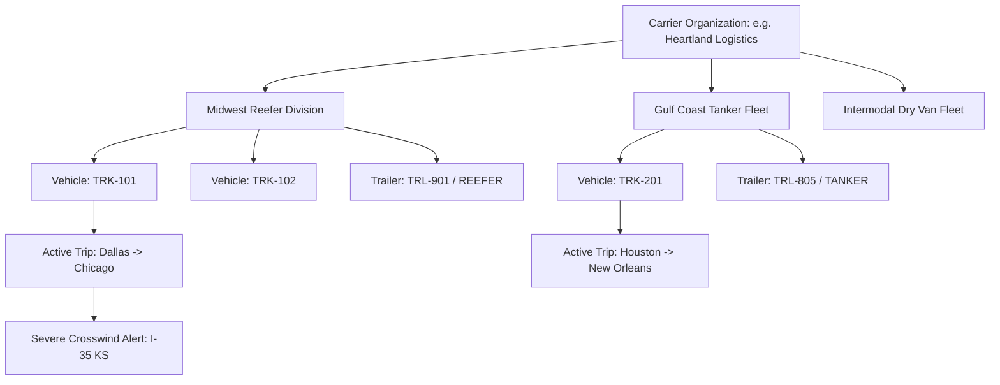
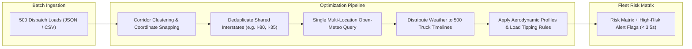

# Multi-Fleet Management & Dispatch Intelligence

## 1. Overview

While single-route dispatching solves tactical trip planning, enterprise motor carriers operate hundreds of commercial tractors across multiple regional divisions. Route Radar's **Multi-Fleet Management Module** delivers fleet-level visibility, corridor hazard deduplication, batch route analysis, and real-time nationwide risk monitoring.

---

## 2. Multi-Tenant Organizational Hierarchy

Route Radar isolates fleet data using a clear relational multi-tenant hierarchy:

### Key Models (`backend/fleet/models.py`)

- **`Organization`**: Top-level tenant container. Provides administrative isolation for carrier accounts.
- **`Fleet`**: Regional operating entity (e.g. *Rocky Mountain Heavy Haul* or *Southeastern Flatbed*). Contains a designated dispatch contact and regional metadata.
- **`Vehicle`**: Commercial power unit (tractor) tracked by `unit_number`, VIN, empty weight, and make/model.
- **`Trailer`**: Trailing equipment classified by aerodynamic type (`DRY_VAN`, `REEFER`, `FLATBED`, `TANKER`). Automatically calculates and enforces the appropriate `sail_area_multiplier`.
- **`Trip`**: Active or scheduled transport run linking tractor, trailer, origin, destination, planned departure, gross load weight, and live risk state (`SCHEDULED`, `IN_TRANSIT`, `COMPLETED`, `CANCELLED`).
- **`WeatherAlert`**: Proactive warning generated when an upcoming corridor segment exceeds safety thresholds, supporting acknowledgment tracking.

---

## 3. High-Throughput Batch Route Analysis

Dispatchers often need to evaluate 50 to 500 daily loads simultaneously prior to morning shift departure.

### 3.1 Batch Optimization Architecture

Running 500 individual routing and weather calls sequentially would result in severe latency and upstream API throttling. Route Radar utilizes a three-tier optimization strategy:

1. **Spatial Snapping**: Snaps coordinates across all 500 routes within a 15-mile grid.
2. **Corridor Deduplication**: If 40 trucks are traversing the I-80 corridor in Nebraska, the atmospheric query for that stretch is executed only once.
3. **Parallel Risk Evaluation**: Evaluates load-weight and trailer aerodynamics concurrently across all trips, returning a comprehensive risk breakdown (`LOW`, `MODERATE`, `HIGH`, `SEVERE`) within 3.5 seconds.

---

## 4. Real-Time Fleet Radar Command Center

The **Fleet Command Center UI** (`/fleet`) provides dispatchers with an interactive command center for tracking nationwide fleet safety:

### 4.1 Continental US Radar Map
- Renders an interactive vector canvas depicting major US interstate corridors (I-80, I-70, I-40, I-10, I-35, I-5, I-95).
- Projects active commercial rigs using spherical Mercator bounds mapping:
  $$x = rac{	ext{lng} - 	ext{minLng}}{	ext{maxLng} - 	ext{minLng}} 	imes 100\%$$
  $$y = rac{	ext{maxLat} - 	ext{lat}}{	ext{maxLat} - 	ext{minLat}} 	imes 100\%$$
- Real-time pins are color-coded by hazard severity:
  - ?? **Low Risk**: Normal operations.
  - ?? **Moderate Caution**: Advise driver of wet roadways.
  - ?? **High Tipping Risk**: Speed reduction mandatory.
  - ?? **Severe / Ground Stop**: Pulsating radar ping indicating mandatory staging.

### 4.2 Rig Telemetry Inspector Drawer
Clicking any truck marker on the US Radar opens the Rig Telemetry Inspector:
- **Driver & Rig Metadata**: Unit #, Driver Name, Fleet Division, Trailer Type.
- **Cargo Diagnostics**: Gross Weight, Highway Speed, Corridor Route.
- **Atmospheric Conditions**: Local Sustained Wind, Wind Gusts, Precipitation Type.
- **Actionable Dispatch Directive**:
  > *"CRITICAL: Drop speed to 45 mph or stage at Emporia, KS travel plaza until cold front passes."*

### 4.3 Multi-Dimension Filtering
Allows dispatchers to instantly isolate at-risk shipments by:
- **Fleet Division** (e.g. *Midwest Express Fleet* vs. *Great Lakes Logistics*)
- **Trailer Equipment** (Dry Van, Reefer, Flatbed, Tanker)
- **Risk Severity** (Filter exclusively to High or Severe alerts)
- **Search Query** (Unit #, Driver Name, or Corridor City)
