# Frontend Architecture & Design System

## 1. Design Philosophy

Route Radar?s user interface is built on a **High-Utility Dark Industrial Aesthetic** designed specifically for freight dispatchers and commercial fleet operators. It prioritizes instant legibility under high-contrast conditions, rapid information density, and fluid micro-interactions.

---

## 2. Core Color Tokens & Design Tokens

```css
:root {
  /* Surfaces */
  --color-bg: #080808;
  --color-surface-black: #0f0f0f;
  --color-card-bg: #141414;
  --color-border: #222222;

  /* Primary Industrial Accent */
  --color-primary: #ffc32a;        /* Caution Gold / Radar Yellow */
  --color-primary-hover: #e0a81d;

  /* Risk Severity Color Spectrum */
  --color-risk-low: #2ecc71;       /* Emerald Green (Level 0) */
  --color-risk-moderate: #f39c12;  /* Amber Yellow (Level 1) */
  --color-risk-high: #e67e22;      /* Vivid Orange (Level 2) */
  --color-risk-severe: #e74c3c;    /* Signal Red (Level 3) */
  --color-risk-notravel: #9b59b6;  /* Royal Purple (Level 4) */

  /* Typography */
  --font-mono: "JetBrains Mono", "SF Mono", monospace;
  --font-sans: -apple-system, BlinkMacSystemFont, "Segoe UI", sans-serif;
}
```

---

## 3. Kinetic Animation & WebGL Engine

### 3.1 Lenis Smooth Inertial Scrolling
Smooth vertical scrolling is powered by [Lenis](https://github.com/darkroomengineering/lenis) and initialized in `frontend/src/App.jsx`.
- **GSAP Synchronization**: Dispatches `lenis.on('scroll', ScrollTrigger.update)` to keep scroll-linked kinetic triggers in sync with browser frame redraws.
- **Scroll Isolation (`data-lenis-prevent`)**: Applied to inner scroll containers (such as the Detailed Checkpoint Telemetry Table and Fullscreen Navigation Drawer) to prevent touch and wheel events from bleeding into the global page scroll.
- **Dynamic Scroll Halting**: When the fullscreen menu overlay opens, `lenis.stop()` freezes the underlying scroll container, resuming seamlessly upon closure.

### 3.2 Rectangular Kinetic Text Reveal (`RectangularTextReveal.jsx`)
Applied to the Hero Section headline and subheadings:
- Splits text into inline-block masked wrappers.
- An animated rectangular block overlay sweeps across the text frame (powered by GSAP timelines) before withdrawing to reveal the underlying gold typography.
- Triggers immediately after the initial preloader dismisses (`isSiteReady = true`).

### 3.3 Three.js WebGL Particle Constellation (`SpiderParticles.jsx`)
Embedded into the application footer:
- **3D Particle Canvas**: Renders 120 dynamic nodes suspended in three-dimensional space using WebGL shaders.
- **Interactive Cursor Spotlight**: Projects raycaster coordinates from the mouse cursor, dynamically drawing connecting web lines to nearby nodes within 140 pixels.
- **Volumetric Bloom**: Includes simulated node glows and center hotspots configured with carrier radar gold (`0xffc32a`).

---

## 4. Component Hierarchy

```mermaid
graph TD
  App[App.jsx: Lenis Scroll Controller & State Store]
  App --> Preloader[Preloader: Kinetic Asset Counter]
  App --> Navbar[Navbar: Scroll-Reactive Header with Fleet Toggle]
  App --> Menu[Menu: Fullscreen Drawer with Quick Presets]
  App --> Hero[Hero Section: RectangularTextReveal Headline]

  subgraph AdvisorConsole ["Single-Route Advisor Console (/)"]
    App --> RouteForm[RouteForm: Autocomplete & Weight Slider]
    App --> WarningBanner[WarningBanner: No-Travel Alert & Advisory]
    App --> MapView[MapView: Leaflet Canvas Polylines & Heatmap]
    App --> ForecastSlider[ForecastSlider: 0-48h Temporal Scrubber]
    App --> RouteCards[RouteCards: Comparative Metrics]
    App --> CheckpointTable[CheckpointTable: Mile-by-Mile Telemetry]
    App --> RiskSandbox[RiskSandbox: Interactive Load Threshold Testing]
  end

  subgraph FleetCommand ["Fleet Command Center (/fleet)"]
    App --> FleetRadar[FleetCommandCenter: US Vector Radar & Pin Array]
    FleetRadar --> Inspector[Rig Inspector: Live Telemetry Drawer]
    FleetRadar --> BatchTable[Batch Audit Results Table]
    FleetRadar --> ActiveTable[Active Rig Roster Table]
  end

  App --> Footer[Footer: Three.js SpiderParticles WebGL Canvas]
```



---

## 5. Mapbox & Leaflet Canvas Optimization

When visualizing routes with hundreds of checkpoints, SVG-based DOM nodes introduce significant frame lag. Route Radar enforces Leaflet?s HTML5 Canvas renderer (`preferCanvas: true`):
- All polyline paths and color-coded hazard segments are drawn directly onto an HTML5 canvas element.
- Reduces DOM node count from over 1,500 elements down to a single canvas element, maintaining a consistent 60fps render rate during zoom and pan operations.
