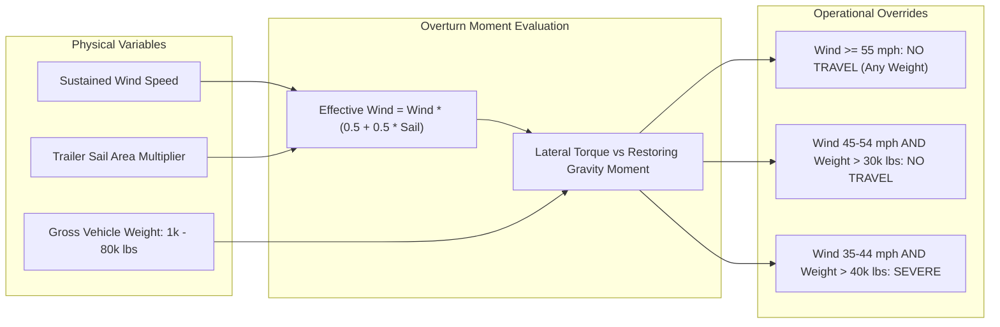

# Risk Engine Specification & Aerodynamic Model

## 1. Executive Summary

The Route Radar **Risk Classification Engine** is the core analytical component that translates raw atmospheric forecasts into operational commercial transport safety decisions. It combines strict meteorological hazard boundaries, vehicle gross weight rollover physics, and aerodynamic trailer sail factor modeling.

---

## 2. Atmospheric Risk Classification Matrix

Every checkpoint sampled along a corridor is classified across three primary weather variables using strict boundary definitions:

| Risk Level | Numeric Code | Sustained Wind (10m) | Rain Rate (Rain + Showers) | Snowfall Accumulation | Color Representation |
|:---:|:---:|:---:|:---:|:---:|:---:|
| **Low** | `0` | `< 25.0 mph` | `< 0.10 in/hr` | `< 0.5 in/hr` | ?? Emerald Green (`#2ecc71`) |
| **Moderate** | `1` | `25.0 ? 34.99 mph` | `0.10 ? 0.2499 in/hr` | `0.5 ? 0.99 in/hr` | ?? Amber Yellow (`#f39c12`) |
| **High** | `2` | `35.0 ? 44.99 mph` | `0.25 ? 0.4999 in/hr` | `1.0 ? 1.99 in/hr` | ?? Vivid Orange (`#e67e22`) |
| **Severe** | `3` | `45.0 ? 54.99 mph` | `0.50 ? 1.00 in/hr` | `2.0 ? 3.0 in/hr` | ?? Signal Red (`#e74c3c`) |
| **No Travel** | `4` | `? 55.0 mph` | `> 1.00 in/hr` | `> 3.0 in/hr` | ?? Royal Purple (`#9b59b6`) |

### Strict Boundary Rule Handling
- **Wind**: Lower bounds are inclusive (`? 55.0 mph` triggers No Travel immediately).
- **Rain**: Exactly `1.00 in/hr` is classified as **Severe** (`3`). Only strictly greater than `1.00 in/hr` triggers **No Travel** (`4`).
- **Snow**: Exactly `3.0 in/hr` is classified as **Severe** (`3`). Only strictly greater than `3.0 in/hr` triggers **No Travel** (`4`).
- **Worst Condition Wins**:
  $$	ext{Base Risk} = \max(	ext{Risk}_{	ext{wind}}, 	ext{Risk}_{	ext{rain}}, 	ext{Risk}_{	ext{snow}})$$

---

## 3. Floating-Point Precision Mitigation

Atmospheric APIs produce IEEE 754 floating-point numbers (e.g. `1.0000000000000002` or `54.999999999999996`), which can cause erratic classification at boundary thresholds.

Route Radar routes all inputs through the `_round_weather` precision filter:
```python
def _round_weather(value: float, decimals: int = 4) -> float:
    return max(0.0, round(float(value), decimals))
```
This guarantees that `1.0000000000000002` evaluates cleanly to `1.0000` (Severe), preventing false No-Travel escalations.

---

## 4. Vehicle Gross Weight & Rollover Physics

Commercial tractor-trailers operate under dynamic tipping physics where high sustained crosswinds exert lateral overturning torque against the trailer's center of gravity.



### Authoritative Load Override Rules

1. **Universal Ground Stop**:
   $$	ext{Wind} \ge 55.0	ext{ mph} \implies 	ext{No Travel (Level 4, Regardless of Load Weight)}$$
2. **Elevated Crosswind with Heavy Load**:
   $$	ext{Wind} \in [45.0, 55.0)	ext{ mph} \land 	ext{Weight} > 30,000	ext{ lbs} \implies 	ext{No Travel (Level 4)}$$
3. **Moderate-High Crosswind with Full Load**:
   $$	ext{Wind} \in [35.0, 45.0)	ext{ mph} \land 	ext{Weight} > 40,000	ext{ lbs} \implies 	ext{Severe (Level 3)}$$

---

## 5. Aerodynamic Trailer Profile Modeling

Traditional risk models treat all commercial rigs as identical 53-ft dry vans. In reality, a flatbed hauling structural steel or a cylindrical tanker has a dramatically lower crosswind sail area than an empty enclosed dry van.

Route Radar introduces the **Aerodynamic Sail Multiplier** ($S_{	ext{area}}$):

| Trailer Type | Sail Multiplier ($S_{	ext{area}}$) | Physical Rationale | Effective Overturning Threshold |
|---|:---:|---|---|
| **`DRY_VAN`** | `1.00` | Full 53-ft enclosed box (approx 500 sq ft lateral cross-section). | Baseline |
| **`REEFER`** | `1.00` | Heavy insulated enclosed box; same high lateral surface area. | Baseline |
| **`FLATBED`** | `0.55` | Low profile cargo with wind passing over the trailer deck. | +8 to 12 mph higher wind tolerance |
| **`TANKER`** | `0.65` | Curved cylindrical shape reduces drag coefficient and vortex shedding. | +5 to 8 mph higher wind tolerance |

### Mathematical Scaling Formulation
When evaluating non-standard trailers ($S_{	ext{area}} 
e 1.0$), effective wind speed ($W_{	ext{eff}}$) is computed as:
$$W_{	ext{eff}} = W_{	ext{actual}} 	imes \left(0.5 + 0.5 	imes S_{	ext{area}}
ight)$$

*Example*: A loaded flatbed ($S_{	ext{area}} = 0.55$) encountering a 48.0 mph crosswind:
$$W_{	ext{eff}} = 48.0 	imes (0.5 + 0.275) = 48.0 	imes 0.775 = 37.2	ext{ mph}$$
Rather than triggering a Level 4 (No Travel) shutdown like a 53-ft dry van, the flatbed's effective overturning force is re-scaled to 37.2 mph, remaining safely in the High Caution tier.

---

## 6. Route Recommendation Scoring Formula

When multiple alternative routes are returned, Route Radar computes a weighted composite penalty score for each route:

$$	ext{Score} = 	ext{Duration}_{	ext{hours}} 	imes 1.0 + \sum_{cp \in 	ext{checkpoints}} 	ext{Penalty}(cp_{	ext{risk}})$$

Where checkpoint penalties are defined as:
- $	ext{Level 0 (Low)} = 0$
- $	ext{Level 1 (Moderate)} = 2$
- $	ext{Level 2 (High)} = 10$
- $	ext{Level 3 (Severe)} = 35$
- $	ext{Level 4 (No Travel)} = 150$

The candidate route with the **lowest composite score** is marked `is_recommended = true`. If a faster route carries a No Travel hazard while a 30-minute detour avoids the storm entirely, the alternative route is strongly recommended with an explanatory rationale.

---

## 7. Departure Window Optimization (?6h Temporal Sweep)

For the primary route, Route Radar evaluates 13 departure scenarios from $T - 6	ext{h}$ to $T + 6	ext{h}$ in 1-hour increments:

1. Translates all checkpoint ETAs forward or backward by the offset $\Delta t$.
2. Queries the pre-cached 49-hour weather array at each checkpoint's new arrival timestamp.
3. Computes the peak risk and total corridor penalty for each hour.
4. If an alternative departure window reduces peak risk (e.g. from High to Low), it generates an operational notice:
   > *"Delaying departure by 2 hours reduces peak crosswind exposure by 16 mph."*
