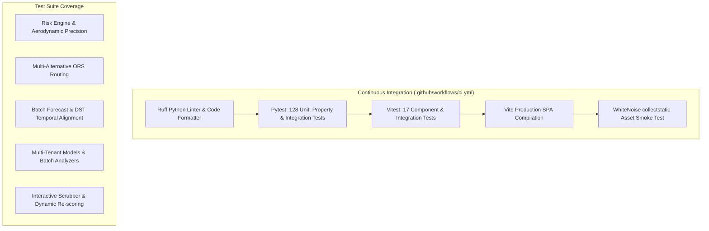

# Testing & Quality Assurance

## 1. Quality Assurance Strategy

Route Radar employs a rigorous, multi-tiered testing methodology designed to validate physical simulation accuracy, meteorological boundary rules, and high-concurrency API performance.



---

## 2. Backend Test Suite (Pytest)

The backend test suite is located in `backend/api/tests/` and `backend/fleet/tests/` and comprises **128 automated tests**:

| Test Module | Test Count | Key Areas Verified |
|---|:---:|---|
| `test_risk_engine.py` | 44 | Boundary conditions for wind, rain, and snow; IEEE 754 float precision; gross weight tipping overrides; trailer aerodynamic multipliers. |
| `test_weather.py` | 18 | Multi-location batch normalization; hourly UTC alignment; rain + showers summation; snowfall depth accumulation (inches/hr vs liquid water equivalent); DST crossing. |
| `test_routing.py` | 13 | Avoidance polygon box generation; spatial detour filtering; waypoint offset on land; graceful fallback to single-route when alternatives are blocked. |
| `test_views.py` | 14 | Input validation; US geographical coordinate bounding; identical origin/destination rejection; weight range checks (1,000?80,000 lbs); DST gap forward snapping. |
| `test_checkpoints.py` | 10 | Haversine sampling at 10/25/50 miles; cumulative distance and driving duration tracking; point-in-time ETA calculation. |
| `test_recommendation.py` | 10 | Composite penalty scoring formula; alternative route ranking; detour tolerance heuristics. |
| `test_heatmap.py` | 5 | Corridor spatial grid bounding box generation; cell risk classification; distance interpolation. |
| `test_integration.py` | 8 | End-to-end route analysis pipeline; deterministic cache key generation; double-checked mutex stampede prevention; demo fixtures. |
| `test_fleet.py` | 6 | Multi-tenant organization and fleet creation; trailer aerodynamic profiles (`DRY_VAN` 1.0x, `FLATBED` 0.55x, `TANKER` 0.65x); batch analysis endpoint (`/api/fleet/trips/batch-analyze`). |

### Running Backend Tests
```bash
# Run all 128 tests
python -m pytest backend/

# Run with verbose output and test names
python -m pytest backend/ -v

# Run risk engine tests exclusively
python -m pytest backend/api/tests/test_risk_engine.py -v
```

---

## 3. Strict Floating-Point Precision & Boundary Tests

A critical vulnerability in weather engines is IEEE 754 precision drift at classification boundaries. Route Radar includes dedicated property tests verifying that exact boundary inputs evaluate deterministically:

- `test_boundary_wind_55`: Asserts `55.0 mph` evaluates to **No Travel** (inclusive boundary).
- `test_boundary_wind_54_99`: Asserts `54.99 mph` evaluates to **Severe**.
- `test_boundary_rain_1_00`: Asserts `1.00 in/hr` evaluates to **Severe** (strict upper bound).
- `test_boundary_rain_1_01`: Asserts `1.01 in/hr` evaluates to **No Travel**.
- `test_boundary_snow_3_0`: Asserts `3.0 in/hr` evaluates to **Severe** (strict upper bound).
- `test_boundary_snow_3_01`: Asserts `3.01 in/hr` evaluates to **No Travel**.
- `test_float_precision_rain_boundary`: Asserts `1.0000000000000002 in/hr` rounds to `1.0000` and evaluates to **Severe**, preventing false ground stops.

---

## 4. Frontend Test Suite (Vitest)

The frontend test suite is located in `frontend/src/__tests__/app.test.jsx` and verified with **17 automated tests**:

| Test ID | Test Case | Expected Behavior |
|---|---|---|
| `FE_01` | Initial App Render | Displays Route Radar header, inputs, and advisory banners without error. |
| `FE_02` | Form Input Validation | Rejects invalid weight outside 1,000?80,000 lbs with clear validation feedback. |
| `FE_03` | Preset Selection | Clicking corridor preset loads Dallas to Houston geometry immediately. |
| `FE_04` | Staged Loading Overlay | Displays staged analysis progress indicators during active API calculation. |
| `FE_05` | Route Card Selection | Clicking alternative candidate route updates the active inspection state. |
| `FE_06` | 48-Hour Forecast Scrubbing | Moving temporal slider dynamically re-scores checkpoint risk labels client-side. |
| `FE_07` | Ground Stop Banner Alert | Emits high-visibility No Travel advisory banner when any checkpoint exceeds Level 4. |
| `FE_08` | Telemetry Table Pagination | Expandable telemetry audit table lists all sampled miles with weather readings. |
| `FE_09` | Risk Sandbox Simulation | Interactively adjusting wind and cargo weight dynamically recalculates tipping risk. |

### Running Frontend Tests
```bash
# Run Vitest test suite once
npm --prefix frontend test

# Run Vitest in interactive watch mode
npm --prefix frontend run test:watch
```

---

## 5. Continuous Integration (GitHub Actions)

Every pull request and push to `main` triggers `.github/workflows/ci.yml`:

1. **Linting Check**: Executes `ruff check backend/` enforcing strict PEP 8 formatting and clean imports.
2. **Backend Test Suite**: Executes `pytest backend/` across all 128 tests.
3. **Frontend Test Suite**: Executes `vitest run` across all 17 component tests.
4. **Build Smoke Test**: Compiles production bundle with `npm run build` and tests WhiteNoise asset collection with `python backend/manage.py collectstatic --noinput`.
