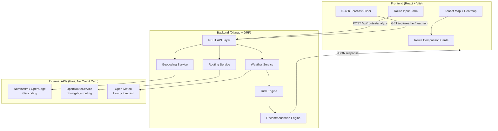
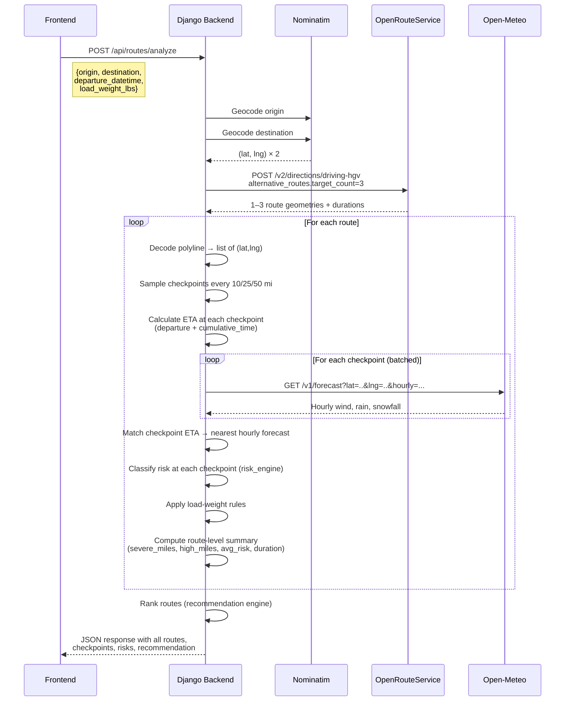

# 🚛 Spotter AI — Truck Route Safety Advisor

## Implementation Plan

---

## 1. Architecture Overview



### Tech Stack

| Layer | Technology | Rationale |
|-------|-----------|-----------|
| **Frontend** | React 18 + Vite | Fast dev server, HMR, modern bundling |
| **Styling** | Vanilla CSS (dark theme, glassmorphism) | Per guidelines — premium aesthetic |
| **Map** | React-Leaflet v5 + Leaflet.heat | Free, OSM tiles, heatmap plugin |
| **Backend** | Django 5 + Django REST Framework | Robust, batteries-included, easy to deploy |
| **Geocoding** | Nominatim (primary) + OpenCage (fallback) | Free, no credit card, USA coverage |
| **Routing** | OpenRouteService `driving-hgv` | Free tier (2,000 req/day), truck-specific, alternative routes |
| **Weather** | Open-Meteo Forecast API | Free, no API key, hourly wind/rain/snow, up to 16 days |
| **Deployment** | Railway / Render (backend) + Vercel (frontend) | Free tiers, easy CI/CD |

---

## 2. API Selection & Justification

### 2.1 OpenRouteService (Routing)

- **Endpoint:** `POST https://api.openrouteservice.org/v2/directions/driving-hgv`
- **Why:** Only free API with a dedicated truck (`driving-hgv`) profile that respects road weight/height restrictions
- **Alternative routes:** `"alternative_routes": {"target_count": 3, "share_factor": 0.6, "weight_factor": 1.8}`
- **Free tier:** 2,000 requests/day, 40 requests/minute
- **API key:** Required (free registration, no credit card)
- **Response gives us:** Encoded polyline geometry, distance (m), duration (s), step-by-step instructions

> [!WARNING]
> ORS `alternative_routes` works best under ~100 km. For cross-country USA trips (e.g., LA → NYC), we must **split the request into segments** or use the response geometry and manually perturb waypoints to generate alternatives. Plan B detailed in §4.2.

### 2.2 Open-Meteo (Weather)

- **Endpoint:** `GET https://api.open-meteo.com/v1/forecast`
- **Why:** No API key, no credit card, 10,000 calls/day, returns hourly wind/rain/snow
- **Parameters we'll use:**
  - `hourly=wind_speed_10m,rain,snowfall,precipitation`
  - `windspeed_unit=mph`
  - `precipitation_unit=inch`
  - `timezone=auto`
  - `forecast_days=3` (covers 0–48h slider)
- **Batching:** Open-Meteo does **not** support multi-location in one call. We'll batch checkpoints by grouping nearby ones and parallelizing with `asyncio.gather()` on the backend.

### 2.3 Nominatim (Geocoding)

- **Endpoint:** `GET https://nominatim.openstreetmap.org/search`
- **Why:** Free, no API key, good USA coverage
- **Rate limit:** 1 req/sec — fine since we only geocode 2 locations per request (origin + destination)
- **Params:** `format=json`, `countrycodes=us`, `limit=5`, `addressdetails=1`

---

## 3. Project Structure

```
Spotter AI/
├── backend/                          # Django project
│   ├── manage.py
│   ├── requirements.txt
│   ├── config/                       # Django project settings
│   │   ├── __init__.py
│   │   ├── settings.py
│   │   ├── urls.py
│   │   ├── wsgi.py
│   │   └── asgi.py
│   ├── api/                          # Main Django app
│   │   ├── __init__.py
│   │   ├── apps.py
│   │   ├── urls.py
│   │   ├── views.py                  # DRF ViewSets
│   │   ├── serializers.py            # Request/Response serializers
│   │   ├── models.py                 # (minimal — mostly stateless)
│   │   └── tests/
│   │       ├── __init__.py
│   │       ├── test_risk_engine.py
│   │       ├── test_recommendation.py
│   │       ├── test_views.py
│   │       └── test_services.py
│   └── services/                     # Business logic (isolated, testable)
│       ├── __init__.py
│       ├── geocoding.py              # Nominatim + OpenCage fallback
│       ├── routing.py                # ORS integration + alternative gen
│       ├── weather.py                # Open-Meteo integration + batching
│       ├── checkpoints.py            # Sample points along polyline
│       ├── risk_engine.py            # Weather → risk classification
│       ├── recommendation.py         # Multi-criteria route ranking
│       └── utils.py                  # Polyline decode, haversine, etc.
│
├── frontend/                         # React + Vite
│   ├── index.html
│   ├── package.json
│   ├── vite.config.js
│   ├── public/
│   │   └── favicon.svg
│   └── src/
│       ├── main.jsx
│       ├── App.jsx
│       ├── index.css                 # Design system (CSS variables, globals)
│       ├── api/
│       │   └── routeApi.js           # Axios calls to Django backend
│       ├── components/
│       │   ├── RouteForm/
│       │   │   ├── RouteForm.jsx
│       │   │   └── RouteForm.css
│       │   ├── MapView/
│       │   │   ├── MapView.jsx       # Leaflet map + routes + heatmap
│       │   │   ├── MapView.css
│       │   │   ├── RouteLayer.jsx    # Polyline for each route
│       │   │   ├── CheckpointMarkers.jsx
│       │   │   └── WeatherHeatmap.jsx
│       │   ├── RouteCards/
│       │   │   ├── RouteCards.jsx     # Side-by-side route comparison
│       │   │   └── RouteCards.css
│       │   ├── ForecastSlider/
│       │   │   ├── ForecastSlider.jsx # 0–48h time slider
│       │   │   └── ForecastSlider.css
│       │   ├── RiskBadge/
│       │   │   ├── RiskBadge.jsx
│       │   │   └── RiskBadge.css
│       │   └── LoadingOverlay/
│       │       ├── LoadingOverlay.jsx
│       │       └── LoadingOverlay.css
│       ├── hooks/
│       │   ├── useRouteAnalysis.js   # Main data-fetching hook
│       │   └── useDebounce.js
│       ├── utils/
│       │   ├── riskColors.js         # Risk level → color mapping
│       │   └── formatters.js         # Time, distance, weight formatters
│       └── constants.js              # Risk thresholds (mirror backend)
│
├── .env.example
├── .gitignore
├── README.md
└── docker-compose.yml                # (optional) local dev
```

---

## 4. Backend — Detailed Design

### 4.1 API Endpoints

| Method | Endpoint | Description | Request Body |
|--------|----------|-------------|-------------|
| `POST` | `/api/routes/analyze` | Main endpoint: geocode → route → checkpoints → weather → risk → recommend | `{origin, destination, departure_datetime, load_weight_lbs}` |
| `GET` | `/api/weather/heatmap` | Weather grid for heatmap slider | `?route_id=<id>&hour_offset=<0-48>` |
| `GET` | `/api/geocode/suggest` | Autocomplete for origin/destination | `?q=<query>&limit=5` |

### 4.2 Core Algorithm — Route Analysis Pipeline



### 4.3 Checkpoint Sampling Logic

```python
# services/checkpoints.py  (pseudocode)

def sample_checkpoints(decoded_polyline, total_distance_miles, interval_miles):
    """
    Walk along the polyline and drop a checkpoint every `interval_miles`.
    
    For each checkpoint, compute:
      - lat, lng
      - cumulative_distance_miles (from origin)
      - cumulative_time_seconds (proportional to distance / total_distance * total_duration)
      - eta (departure_datetime + cumulative_time)
    
    Intervals:
      - 10 miles  → most granular (used for primary risk analysis)
      - 25 miles  → medium density (used for heatmap overlay)
      - 50 miles  → sparse (fallback for very long routes >500 mi to reduce API calls)
    
    Auto-select interval based on route length:
      - < 200 mi  → 10 mi interval
      - 200-500 mi → 25 mi interval
      - > 500 mi  → 50 mi interval
    """
```

### 4.4 Risk Engine

```python
# services/risk_engine.py

RISK_LEVELS = {
    0: "Low",
    1: "Moderate",
    2: "High",
    3: "Severe",
    4: "No Travel"
}

WIND_THRESHOLDS = [
    (55, 4),   # ≥55 mph → No Travel
    (45, 3),   # 45-54 → Severe
    (35, 2),   # 35-44 → High
    (25, 1),   # 25-34 → Moderate
    (0,  0),   # <25   → Low
]

RAIN_THRESHOLDS = [
    (1.00, 4),  # >1.00 in/hr → No Travel
    (0.50, 3),  # 0.50-1.00   → Severe
    (0.25, 2),  # 0.25-0.50   → High
    (0.10, 1),  # 0.10-0.25   → Moderate
    (0.00, 0),  # <0.10       → Low
]

SNOW_THRESHOLDS = [
    (3.0, 4),   # >3.0 in/hr → No Travel
    (2.0, 3),   # 2.0-3.0    → Severe
    (1.0, 2),   # 1.0-2.0    → High
    (0.5, 1),   # 0.5-1.0    → Moderate
    (0.0, 0),   # <0.5       → Low
]

def classify_weather(wind_mph, rain_in_hr, snow_in_hr):
    """Return the WORST (max) risk level across all three conditions."""
    wind_risk = _lookup(wind_mph, WIND_THRESHOLDS)
    rain_risk = _lookup(rain_in_hr, RAIN_THRESHOLDS)
    snow_risk = _lookup(snow_in_hr, SNOW_THRESHOLDS)
    return max(wind_risk, rain_risk, snow_risk)

def apply_load_rules(base_risk, wind_mph, load_weight_lbs):
    """
    Override risk based on load weight:
    - ≥55 mph wind → No Travel (ANY load)  [already handled by classify_weather]
    - 45-54 mph + >30,000 lb → No Travel
    - 35-44 mph + >40,000 lb → Severe
    """
    if 45 <= wind_mph < 55 and load_weight_lbs > 30000:
        return max(base_risk, 4)  # No Travel
    if 35 <= wind_mph < 45 and load_weight_lbs > 40000:
        return max(base_risk, 3)  # Severe
    return base_risk
```

### 4.5 Recommendation Engine

```python
# services/recommendation.py

def rank_routes(routes):
    """
    Sort routes by preference (ascending = better):
      1. Fewest "Severe" miles
      2. Fewest "High" miles
      3. Lowest average risk score
      4. Shortest travel time

    Each route dict has:
      - severe_miles: float
      - high_miles: float
      - avg_risk: float (0.0 - 4.0)
      - duration_seconds: int
      - has_no_travel: bool (if any checkpoint is "No Travel")
    
    Routes with "No Travel" checkpoints are pushed to the bottom.
    """
    def sort_key(route):
        no_travel_penalty = 1 if route["has_no_travel"] else 0
        return (
            no_travel_penalty,
            route["severe_miles"],
            route["high_miles"],
            route["avg_risk"],
            route["duration_seconds"],
        )
    
    return sorted(routes, key=sort_key)
```

### 4.6 Weather Heatmap Data

For the 0–48h forecast slider, we generate a **grid** of weather points along the route corridor:

```python
# services/weather.py

def generate_heatmap_grid(route_polyline, corridor_width_miles=30, grid_spacing_miles=15):
    """
    1. Create a bounding box around the route ± corridor_width
    2. Generate a grid of lat/lng points within the corridor
    3. For each grid point, fetch 48-hour hourly forecast from Open-Meteo
    4. Cache all 48 hours of data
    5. Frontend requests a specific hour_offset (0-48) and we return
       the pre-cached weather at that offset for all grid points.
    
    Returns: {
        hour_offset: [
            {lat, lng, risk_level, wind, rain, snow},
            ...
        ]
    }
    """
```

### 4.7 Caching Strategy

| What | Where | TTL | Why |
|------|-------|-----|-----|
| Geocoding results | Django cache (Redis/in-memory) | 24 hours | Same city lookups |
| Route geometries | Per-session (response) | Request-scoped | ORS rate limits |
| Weather forecasts | Django cache | 1 hour | Weather updates hourly |
| Heatmap grid data | Django cache | 1 hour | Expensive to compute |

---

## 5. Frontend — Detailed Design

### 5.1 Page Layout

```
┌─────────────────────────────────────────────────────────────────┐
│  🚛  SPOTTER AI — Truck Route Safety Advisor          [dark bg] │
├────────────────────┬────────────────────────────────────────────┤
│                    │                                            │
│   ROUTE INPUT      │           INTERACTIVE MAP                  │
│   ─────────────    │                                            │
│   📍 Origin        │    ┌──────────────────────────────┐        │
│   📍 Destination   │    │                              │        │
│   📅 Departure     │    │   Leaflet Map                │        │
│   ⚖️  Load Weight  │    │   • 3 route polylines        │        │
│                    │    │   • Checkpoint markers        │        │
│   [Analyze Routes] │    │   • Weather heatmap overlay   │        │
│                    │    │                              │        │
│   ─────────────    │    └──────────────────────────────┘        │
│                    │                                            │
│   ROUTE CARDS      │    ┌──────────────────────────────┐        │
│   ─────────────    │    │  🕐 Forecast Slider (0-48h)  │        │
│   🏆 Route 1       │    │  ◄━━━━━━━━●━━━━━━━━━━━━━━━► │        │
│     ★ Recommended  │    └──────────────────────────────┘        │
│     45 mi, 52 min  │                                            │
│     Risk: Low      │                                            │
│     3 checkpoints  │                                            │
│                    │                                            │
│   Route 2          │                                            │
│     48 mi, 55 min  │                                            │
│     Risk: Moderate │                                            │
│                    │                                            │
│   Route 3          │                                            │
│     52 mi, 58 min  │                                            │
│     Risk: High     │                                            │
│                    │                                            │
├────────────────────┴────────────────────────────────────────────┤
│  ROUTE DETAIL (expandable)                                      │
│  ┌──────────────────────────────────────────────────────────┐   │
│  │ Checkpoint │ Mile │ ETA        │ Wind │ Rain │ Snow │Risk│   │
│  │ CP-1       │ 10   │ 2:30 PM    │ 22   │ 0.05 │ 0    │Low │   │
│  │ CP-2       │ 20   │ 2:45 PM    │ 38   │ 0.12 │ 0    │High│   │
│  │ ...        │      │            │      │      │      │    │   │
│  └──────────────────────────────────────────────────────────┘   │
└─────────────────────────────────────────────────────────────────┘
```

### 5.2 Component Responsibilities

| Component | Responsibility |
|-----------|---------------|
| `RouteForm` | Input form with autocomplete, date/time picker, weight slider (5,000–80,000 lbs). Validates all fields before submit. |
| `MapView` | Leaflet container. Fits bounds to show all routes. Hosts child layers. |
| `RouteLayer` | Renders one `<Polyline>` per route. Color-codes by risk (green/yellow/orange/red). Highlights selected route. |
| `CheckpointMarkers` | Circle markers at each checkpoint. Popup shows wind/rain/snow/risk on click. Color matches risk level. |
| `WeatherHeatmap` | `L.heatLayer` overlay controlled by the forecast slider. Intensity = risk level. |
| `ForecastSlider` | Range input (0–48 hours). Debounced. Shows current time label. Drives heatmap data refresh. |
| `RouteCards` | Summary cards for each route. Shows distance, duration, risk breakdown, checkpoint count. Recommended route gets a badge. Click to highlight on map. |
| `RiskBadge` | Small pill showing risk level with color + icon. |
| `LoadingOverlay` | Full-screen glass overlay with animated truck icon during analysis. |

### 5.3 Design System (CSS Variables)

```css
:root {
  /* Dark Theme */
  --bg-primary: #0a0e17;
  --bg-secondary: #111827;
  --bg-card: rgba(17, 24, 39, 0.8);
  --bg-glass: rgba(255, 255, 255, 0.05);
  --border-glass: rgba(255, 255, 255, 0.1);

  /* Text */
  --text-primary: #f1f5f9;
  --text-secondary: #94a3b8;
  --text-muted: #64748b;

  /* Risk Colors */
  --risk-low: #22c55e;
  --risk-moderate: #f59e0b;
  --risk-high: #f97316;
  --risk-severe: #ef4444;
  --risk-no-travel: #7c2d12;

  /* Accent */
  --accent-primary: #3b82f6;
  --accent-glow: rgba(59, 130, 246, 0.3);

  /* Typography */
  --font-family: 'Inter', system-ui, sans-serif;
  --font-mono: 'JetBrains Mono', monospace;

  /* Spacing */
  --radius-sm: 8px;
  --radius-md: 12px;
  --radius-lg: 16px;

  /* Transitions */
  --transition-fast: 150ms ease;
  --transition-normal: 250ms ease;
}
```

---

## 6. Data Flow & Response Schema

### 6.1 Request

```json
POST /api/routes/analyze
{
  "origin": "Dallas, TX",
  "destination": "Houston, TX",
  "departure_datetime": "2026-10-15T08:00:00-05:00",
  "load_weight_lbs": 35000
}
```

### 6.2 Response

```json
{
  "origin": {"name": "Dallas, TX", "lat": 32.7767, "lng": -96.797},
  "destination": {"name": "Houston, TX", "lat": 29.7604, "lng": -95.3698},
  "departure_datetime": "2026-10-15T08:00:00-05:00",
  "load_weight_lbs": 35000,
  "recommended_route_index": 0,
  "routes": [
    {
      "index": 0,
      "name": "Route 1 (I-45 S)",
      "is_recommended": true,
      "geometry": [[32.7767, -96.797], ...],
      "distance_miles": 239.5,
      "duration_seconds": 13140,
      "duration_display": "3h 39m",
      "summary": {
        "avg_risk": 0.8,
        "max_risk": 2,
        "max_risk_label": "High",
        "severe_miles": 0,
        "high_miles": 25,
        "moderate_miles": 50,
        "low_miles": 164.5,
        "no_travel_miles": 0,
        "has_no_travel": false
      },
      "checkpoints": [
        {
          "index": 0,
          "lat": 32.65,
          "lng": -96.72,
          "cumulative_miles": 10,
          "eta": "2026-10-15T08:24:00-05:00",
          "weather": {
            "wind_mph": 18.5,
            "rain_in_hr": 0.02,
            "snow_in_hr": 0.0,
            "temperature_f": 72,
            "description": "Partly cloudy"
          },
          "risk": {
            "base_level": 0,
            "adjusted_level": 0,
            "label": "Low",
            "factors": []
          }
        }
      ]
    }
  ],
  "heatmap_data": {
    "corridor_points": [
      {"lat": 32.5, "lng": -96.8, "forecasts": [
        {"hour_offset": 0, "risk_level": 0, "wind_mph": 15, "rain_in_hr": 0},
        {"hour_offset": 1, "risk_level": 1, "wind_mph": 28, "rain_in_hr": 0.12}
      ]}
    ]
  }
}
```

---

## 7. Error Handling & Edge Cases

### 7.1 Input Validation

| Field | Validation | Error Message |
|-------|-----------|---------------|
| Origin | Non-empty, geocodable to USA location | "Could not find a location in the USA matching '{input}'" |
| Destination | Non-empty, different from origin, geocodable | "Origin and destination cannot be the same" |
| Departure | ISO datetime, within next 48 hours | "Departure must be within the next 48 hours (weather forecast limit)" |
| Load weight | 1,000 – 80,000 lbs, numeric | "Load weight must be between 1,000 and 80,000 lbs" |

### 7.2 API Error Handling

| API | Failure Mode | Handling |
|-----|-------------|----------|
| Nominatim | Rate limited (429) | Retry with exponential backoff (1s, 2s, 4s). Fall back to OpenCage. |
| Nominatim | No results | Return helpful error: "No USA location found for '{query}'. Try a more specific address." |
| ORS | Rate limited (429) | Retry 3× with backoff. If still failing, return error with "Please try again in a few minutes." |
| ORS | < 3 alternatives returned | Proceed with available routes (1 or 2). Show notice: "Only {n} route(s) available for this trip." |
| ORS | Route not found (e.g., island) | Return error: "No drivable route found between these locations." |
| Open-Meteo | Timeout / 5xx | Retry 2×. If failing, mark checkpoints as "Weather unavailable" with risk = "Unknown". |
| Open-Meteo | Coordinates outside coverage | Skip checkpoint weather, mark as "No data". |

### 7.3 Edge Cases

| Edge Case | How We Handle It |
|-----------|-----------------|
| **Very short route (<10 mi)** | Use 2-mile checkpoint intervals. Minimum 2 checkpoints (start + end). |
| **Very long route (>1,000 mi)** | Use 50-mile intervals. Cap at 40 checkpoints to stay under Open-Meteo rate limits. |
| **Route crosses time zones** | ORS returns duration in seconds. We compute per-checkpoint ETA from departure + cumulative seconds. Time zone is resolved per checkpoint using `timezonefinder` library. |
| **Departure in the past** | Reject with validation error. |
| **Departure > 48h in future** | Warn user: "Weather forecasts beyond 48 hours are less accurate." Allow up to 7 days (Open-Meteo supports 16 days). |
| **All routes have "No Travel"** | Still show all routes but with prominent warning banner: "⚠️ All routes have dangerous conditions. Consider delaying your trip." |
| **Identical routes from ORS** | Detect duplicate geometries (>90% overlap). Deduplicate and show notice. |
| **Load weight at boundary** | Thresholds use strict inequalities as specified: `>30,000` not `≥30,000`. |

---

## 8. Bottlenecks & Performance Mitigations

### 8.1 Identified Bottlenecks

| # | Bottleneck | Impact | Mitigation |
|---|-----------|--------|-----------|
| 1 | **Open-Meteo calls per route** — a 500-mile route at 25-mi intervals = 20 checkpoints × 3 routes = 60 API calls | Slow response, rate limit risk | **Batch with `asyncio.gather()`** — fire all requests concurrently (Open-Meteo allows 600/min). Group nearby checkpoints (<5 mi apart) and use one forecast for both. |
| 2 | **ORS alternative routes for long distances** | May return only 1 route or timeout | **Fallback strategy:** If ORS returns <3 routes, generate alternatives by adding intermediate waypoints (e.g., shift midpoint ±30 miles perpendicular to the direct line). Retry with waypoints. |
| 3 | **Heatmap grid computation** | Generating a grid + fetching weather for 100+ points is slow | **Lazy loading:** Compute heatmap data asynchronously AFTER returning the main route analysis. Frontend shows routes first, then loads heatmap. Use WebSocket or polling for heatmap data. |
| 4 | **Frontend re-renders with large datasets** | Map lag with 3 polylines + 60 markers + heatmap | **Memoization:** `useMemo` for all map data. Virtualize checkpoint markers (show only at certain zoom levels). Debounce slider at 200ms. |
| 5 | **Nominatim 1 req/sec rate limit** | Two sequential geocoding calls = 2 seconds minimum | **Parallel-safe:** Origin + destination geocoding run in parallel with 1.1s stagger. Cache results aggressively. |
| 6 | **Polyline decoding for long routes** | ORS returns large encoded polylines | Decode on backend, simplify with Douglas-Peucker algorithm before sending to frontend. Keep full-res version for checkpoint computation. |

### 8.2 API Rate Limit Budget (Per Request)

| API | Calls Made | Daily Limit | Margin |
|-----|-----------|-------------|--------|
| Nominatim | 2 (origin + dest) | ~86,400 (1/sec) | Very safe |
| ORS | 1 (returns up to 3 routes) | 2,000/day | ~2,000 analyses/day |
| Open-Meteo | 20-60 (checkpoints) + 50-100 (heatmap grid) | 10,000/day | ~60-100 analyses/day |

> [!IMPORTANT]
> Open-Meteo is the bottleneck. For production, either:
> - Self-host Open-Meteo (open-source)
> - Cache aggressively (nearby coordinates share forecasts)
> - Reduce heatmap grid density

---

## 9. Test Plan

### 9.1 Unit Tests (Backend — `pytest` + `Django TestCase`)

#### Risk Engine Tests (`test_risk_engine.py`)

| Test ID | Test Name | Input | Expected Output |
|---------|-----------|-------|-----------------|
| RE-01 | `test_low_risk_all_clear` | wind=15, rain=0.05, snow=0 | Risk level 0 (Low) |
| RE-02 | `test_wind_moderate` | wind=30, rain=0, snow=0 | Risk level 1 (Moderate) |
| RE-03 | `test_wind_high` | wind=40, rain=0, snow=0 | Risk level 2 (High) |
| RE-04 | `test_wind_severe` | wind=50, rain=0, snow=0 | Risk level 3 (Severe) |
| RE-05 | `test_wind_no_travel` | wind=60, rain=0, snow=0 | Risk level 4 (No Travel) |
| RE-06 | `test_rain_moderate` | wind=0, rain=0.15, snow=0 | Risk level 1 (Moderate) |
| RE-07 | `test_rain_high` | wind=0, rain=0.30, snow=0 | Risk level 2 (High) |
| RE-08 | `test_rain_severe` | wind=0, rain=0.75, snow=0 | Risk level 3 (Severe) |
| RE-09 | `test_rain_no_travel` | wind=0, rain=1.50, snow=0 | Risk level 4 (No Travel) |
| RE-10 | `test_snow_moderate` | wind=0, rain=0, snow=0.7 | Risk level 1 (Moderate) |
| RE-11 | `test_snow_high` | wind=0, rain=0, snow=1.5 | Risk level 2 (High) |
| RE-12 | `test_snow_severe` | wind=0, rain=0, snow=2.5 | Risk level 3 (Severe) |
| RE-13 | `test_snow_no_travel` | wind=0, rain=0, snow=3.5 | Risk level 4 (No Travel) |
| RE-14 | `test_worst_condition_wins` | wind=30(Mod), rain=0.30(High), snow=0 | Risk level 2 (High) |
| RE-15 | `test_all_conditions_severe` | wind=50, rain=0.75, snow=2.5 | Risk level 3 (Severe) |
| RE-16 | `test_boundary_wind_25` | wind=25, rain=0, snow=0 | Risk level 1 (Moderate) — boundary inclusive |
| RE-17 | `test_boundary_wind_24.9` | wind=24.9, rain=0, snow=0 | Risk level 0 (Low) |
| RE-18 | `test_boundary_rain_0.10` | wind=0, rain=0.10, snow=0 | Risk level 1 (Moderate) |
| RE-19 | `test_boundary_snow_0.5` | wind=0, rain=0, snow=0.5 | Risk level 1 (Moderate) |

#### Load Rule Tests (`test_risk_engine.py`)

| Test ID | Test Name | Input | Expected Output |
|---------|-----------|-------|-----------------|
| LR-01 | `test_load_rule_55mph_any_weight` | wind=55, load=10000 | No Travel (4) |
| LR-02 | `test_load_rule_55mph_heavy` | wind=55, load=50000 | No Travel (4) |
| LR-03 | `test_load_rule_45_54_over_30k` | wind=50, load=35000 | No Travel (4) |
| LR-04 | `test_load_rule_45_54_under_30k` | wind=50, load=25000 | Severe (3) — no load override |
| LR-05 | `test_load_rule_45_54_exactly_30k` | wind=50, load=30000 | Severe (3) — boundary: `>30,000` |
| LR-06 | `test_load_rule_35_44_over_40k` | wind=40, load=45000 | Severe (3) |
| LR-07 | `test_load_rule_35_44_under_40k` | wind=40, load=35000 | High (2) — no load override |
| LR-08 | `test_load_rule_35_44_exactly_40k` | wind=40, load=40000 | High (2) — boundary: `>40,000` |
| LR-09 | `test_load_rule_no_override_calm` | wind=20, load=60000 | Low (0) — load rules don't apply at low wind |

#### Recommendation Engine Tests (`test_recommendation.py`)

| Test ID | Test Name | Scenario | Expected Winner |
|---------|-----------|----------|-----------------|
| RC-01 | `test_fewest_severe_wins` | R1: 10 severe mi, R2: 5 severe mi | R2 |
| RC-02 | `test_severe_tie_high_breaks` | R1: 5 severe + 20 high, R2: 5 severe + 10 high | R2 |
| RC-03 | `test_all_ties_shortest_time` | Equal risk, R1: 3600s, R2: 3000s | R2 |
| RC-04 | `test_no_travel_pushed_to_bottom` | R1: has no_travel=true, R2: severe but no no_travel | R2 |
| RC-05 | `test_avg_risk_tiebreak` | Equal severe + high, R1: avg 1.5, R2: avg 1.2 | R2 |
| RC-06 | `test_single_route` | Only 1 route returned | That route is recommended |
| RC-07 | `test_all_no_travel` | All routes have no_travel | Route with fewest severe miles recommended + warning |

#### Checkpoint Sampling Tests (`test_services.py`)

| Test ID | Test Name | Scenario | Expected |
|---------|-----------|----------|----------|
| CS-01 | `test_10mi_interval_short_route` | 50 mi route | 5 checkpoints at miles 10,20,30,40,50 |
| CS-02 | `test_25mi_interval_medium_route` | 300 mi route | 12 checkpoints |
| CS-03 | `test_50mi_interval_long_route` | 800 mi route | 16 checkpoints |
| CS-04 | `test_very_short_route` | 5 mi route | 2 checkpoints (start + end) |
| CS-05 | `test_eta_calculation` | 100 mi, 2h, depart 8AM | Checkpoint at 50mi → ETA 9:00 AM |
| CS-06 | `test_checkpoint_on_polyline` | Given polyline | All checkpoints lie within 0.1mi of polyline |

### 9.2 Integration Tests (Backend)

| Test ID | Test Name | What It Tests |
|---------|-----------|---------------|
| IT-01 | `test_full_pipeline_dallas_houston` | End-to-end: geocode → route → weather → risk → recommend |
| IT-02 | `test_api_error_recovery_ors_down` | Mock ORS 500 → verify graceful error response |
| IT-03 | `test_api_error_recovery_weather_down` | Mock Open-Meteo timeout → verify "unknown" risk fallback |
| IT-04 | `test_geocode_fallback` | Mock Nominatim 429 → verify OpenCage fallback |
| IT-05 | `test_response_schema_validation` | Verify response matches documented schema |
| IT-06 | `test_concurrent_requests` | 5 simultaneous requests → all succeed |

### 9.3 Input Validation Tests (Backend)

| Test ID | Test Name | Input | Expected |
|---------|-----------|-------|----------|
| IV-01 | `test_empty_origin` | origin="" | 400: "Origin is required" |
| IV-02 | `test_empty_destination` | destination="" | 400: "Destination is required" |
| IV-03 | `test_same_origin_destination` | origin=dest="Dallas" | 400: "Origin and destination must differ" |
| IV-04 | `test_weight_below_min` | weight=500 | 400: "Weight must be ≥1,000 lbs" |
| IV-05 | `test_weight_above_max` | weight=90000 | 400: "Weight must be ≤80,000 lbs" |
| IV-06 | `test_weight_non_numeric` | weight="heavy" | 400: "Weight must be a number" |
| IV-07 | `test_departure_in_past` | departure=yesterday | 400: "Departure must be in the future" |
| IV-08 | `test_departure_invalid_format` | departure="next tuesday" | 400: "Invalid datetime format" |
| IV-09 | `test_non_usa_location` | origin="Paris, France" | 400: "Location must be within the USA" |
| IV-10 | `test_ungeocodable_location` | origin="asdfghjkl" | 400: "Could not find location" |

### 9.4 Frontend Tests (Vitest + React Testing Library)

| Test ID | Test Name | What It Tests |
|---------|-----------|---------------|
| FE-01 | `test_form_renders_all_fields` | All input fields present and labeled |
| FE-02 | `test_form_validates_empty_submit` | Error messages shown for all empty fields |
| FE-03 | `test_form_weight_slider_range` | Slider min=1000, max=80000, step=1000 |
| FE-04 | `test_loading_state` | Loading overlay shows during API call |
| FE-05 | `test_route_cards_render` | 3 route cards rendered from mock data |
| FE-06 | `test_recommended_badge` | Recommended route has "★ Recommended" badge |
| FE-07 | `test_risk_badge_colors` | Each risk level shows correct color |
| FE-08 | `test_map_renders` | Leaflet map initializes without errors |
| FE-09 | `test_forecast_slider_range` | Slider range 0-48, step 1 |
| FE-10 | `test_error_display` | API error response shows user-friendly message |
| FE-11 | `test_no_travel_warning_banner` | Warning banner appears when all routes have no_travel |
| FE-12 | `test_checkpoint_popup` | Clicking checkpoint marker shows weather details |

### 9.5 End-to-End Tests (Playwright — optional, stretch goal)

| Test ID | Test Name | Scenario |
|---------|-----------|----------|
| E2E-01 | `test_full_flow_happy_path` | Enter Dallas→Houston, submit, see routes on map |
| E2E-02 | `test_route_card_click_highlights_map` | Click route card → corresponding polyline is highlighted |
| E2E-03 | `test_slider_updates_heatmap` | Move slider → heatmap visually changes |
| E2E-04 | `test_responsive_mobile` | Viewport 375px → layout stacks vertically |

---

## 10. Implementation Phases & Timeline

### Phase 1: Foundation (Backend Core) — ~4 hours

| # | Task | Details |
|---|------|---------|
| 1.1 | Initialize Django project | `django-admin startproject config backend` |
| 1.2 | Create `api` app | Models, serializers, views stubs |
| 1.3 | Build `services/geocoding.py` | Nominatim client with retry + OpenCage fallback |
| 1.4 | Build `services/routing.py` | ORS `driving-hgv` client with alternative routes |
| 1.5 | Build `services/utils.py` | Polyline decoder, haversine distance |
| 1.6 | Build `services/checkpoints.py` | Checkpoint sampling along polyline |
| 1.7 | Write unit tests for utilities | Polyline decode, haversine, checkpoints |

### Phase 2: Risk & Recommendation Engine — ~3 hours

| # | Task | Details |
|---|------|---------|
| 2.1 | Build `services/weather.py` | Open-Meteo client with async batching |
| 2.2 | Build `services/risk_engine.py` | Weather classification + load rules |
| 2.3 | Build `services/recommendation.py` | Multi-criteria route ranking |
| 2.4 | Write all risk engine unit tests | RE-01 through RE-19 |
| 2.5 | Write all load rule unit tests | LR-01 through LR-09 |
| 2.6 | Write recommendation tests | RC-01 through RC-07 |
| 2.7 | Wire up `POST /api/routes/analyze` | Full pipeline view |

### Phase 3: Frontend Foundation — ~3 hours

| # | Task | Details |
|---|------|---------|
| 3.1 | Initialize Vite + React project | `npx create-vite frontend --template react` |
| 3.2 | Set up design system (`index.css`) | CSS variables, dark theme, typography |
| 3.3 | Build `RouteForm` component | Inputs, validation, date picker, weight slider |
| 3.4 | Build `LoadingOverlay` component | Animated truck loader |
| 3.5 | Set up API client (`routeApi.js`) | Axios instance with error handling |
| 3.6 | Build `useRouteAnalysis` hook | State management for API call |

### Phase 4: Map & Visualization — ~4 hours

| # | Task | Details |
|---|------|---------|
| 4.1 | Build `MapView` component | Leaflet container with OSM tiles |
| 4.2 | Build `RouteLayer` component | Color-coded polylines for each route |
| 4.3 | Build `CheckpointMarkers` component | Risk-colored circles with popups |
| 4.4 | Build `WeatherHeatmap` component | L.heatLayer with intensity mapping |
| 4.5 | Build `ForecastSlider` component | 0-48h range slider with debounce |
| 4.6 | Build `RouteCards` component | Summary cards with risk breakdown |
| 4.7 | Build `RiskBadge` component | Color-coded risk pills |

### Phase 5: Integration & Polish — ~3 hours

| # | Task | Details |
|---|------|---------|
| 5.1 | Connect frontend to backend | CORS config, proxy setup, full flow testing |
| 5.2 | Add error handling UI | Error banners, retry buttons, empty states |
| 5.3 | Add responsive design | Mobile breakpoints, collapsible sidebar |
| 5.4 | Performance optimization | Memoization, debouncing, lazy loading |
| 5.5 | Integration tests | IT-01 through IT-06 |
| 5.6 | Frontend tests | FE-01 through FE-12 |

### Phase 6: Deployment & Documentation — ~2 hours

| # | Task | Details |
|---|------|---------|
| 6.1 | Write README.md | Setup, architecture, API docs |
| 6.2 | Create `.env.example` | All required env vars documented |
| 6.3 | Configure deployment | Railway (backend) + Vercel (frontend) |
| 6.4 | Record Loom walkthrough | 5-10 min demo of full flow |

---

## 11. Environment Variables

```bash
# .env.example

# Django
DJANGO_SECRET_KEY=your-secret-key-here
DJANGO_DEBUG=True
DJANGO_ALLOWED_HOSTS=localhost,127.0.0.1

# OpenRouteService
ORS_API_KEY=your-ors-api-key       # Free: https://openrouteservice.org/dev/#/signup

# OpenCage (fallback geocoder)
OPENCAGE_API_KEY=your-opencage-key  # Free: https://opencagedata.com/users/sign_up

# Open-Meteo (no key needed)
# OPEN_METEO_BASE_URL=https://api.open-meteo.com/v1

# Frontend URL (for CORS)
FRONTEND_URL=http://localhost:5173

# Cache (optional — defaults to in-memory)
# REDIS_URL=redis://localhost:6379/0
```

---

## 12. Dependencies

### Backend (`requirements.txt`)

```
django>=5.0,<6.0
djangorestframework>=3.15
django-cors-headers>=4.3
requests>=2.31
polyline>=2.0              # Decode ORS encoded polylines
timezonefinder>=6.2        # Resolve timezone from lat/lng
python-dateutil>=2.8       # Datetime parsing
python-dotenv>=1.0         # Environment variables
gunicorn>=21.0             # Production WSGI server
whitenoise>=6.5            # Static files in production
aiohttp>=3.9               # Async HTTP for parallel weather calls
pytest>=8.0                # Testing
pytest-django>=4.7         # Django test integration
pytest-asyncio>=0.23       # Async test support
responses>=0.25            # Mock HTTP responses in tests
```

### Frontend (`package.json` key dependencies)

```json
{
  "dependencies": {
    "react": "^18.3",
    "react-dom": "^18.3",
    "react-leaflet": "^5.0",
    "leaflet": "^1.9",
    "leaflet.heat": "^0.2",
    "axios": "^1.7",
    "date-fns": "^3.6"
  },
  "devDependencies": {
    "vite": "^6.0",
    "@vitejs/plugin-react": "^4.3",
    "vitest": "^2.0",
    "@testing-library/react": "^16.0",
    "@testing-library/jest-dom": "^6.4",
    "jsdom": "^24.0"
  }
}
```

---

## 13. Risks & Mitigations

| Risk | Likelihood | Impact | Mitigation |
|------|-----------|--------|-----------|
| ORS returns only 1 route for long distances | High | Medium | Fallback: generate alternatives with offset waypoints |
| Open-Meteo rate limit hit | Medium | High | Aggressive caching, reduce heatmap grid density, batch requests |
| Weather data unavailable for some checkpoints | Low | Medium | Mark as "Unknown" risk, don't penalize in ranking |
| Leaflet performance with many markers | Medium | Medium | Cluster markers, show only at zoom level ≥10, use `useMemo` |
| ORS API key revoked or quota exceeded | Low | Critical | Env var config, monitor usage, document OSRM self-host fallback |
| Time zone edge cases (route crosses zones) | Medium | Low | Use `timezonefinder` for per-checkpoint timezone resolution |
| Open-Meteo returns rain in mm, snow in cm | High | Critical | Unit conversion in weather service: mm→inches, cm→inches |

> [!CAUTION]
> **Unit conversion is critical!** Open-Meteo returns rain in **mm** and snow in **cm**. Our risk thresholds are in **inches/hour**. The weather service MUST convert:
> - Rain: `mm * 0.03937 = inches`
> - Snow: `cm * 0.3937 = inches`
> 
> Failure to convert will render ALL risk classifications incorrect.

---

## 14. Acceptance Criteria

- [ ] User can enter origin, destination, departure datetime, and load weight
- [ ] App geocodes USA locations and shows validation errors for invalid inputs
- [ ] App displays 3 (or fewer, with notice) route options on the map
- [ ] Checkpoints are sampled every 10/25/50 miles (auto-selected by route length)
- [ ] Weather is fetched for each checkpoint using the truck's ETA at that point
- [ ] Risk is classified correctly per the provided thresholds (all 19 test cases pass)
- [ ] Load weight rules correctly override base risk (all 9 test cases pass)
- [ ] Routes are ranked by the specified multi-criteria algorithm
- [ ] Recommended route is clearly marked with a badge
- [ ] Route cards show distance, duration, risk breakdown, and checkpoint details
- [ ] Map shows color-coded polylines (green → red by risk)
- [ ] Checkpoint markers show weather details on click
- [ ] Weather heatmap overlay updates with the 0–48h forecast slider
- [ ] App handles all error cases gracefully (API failures, invalid inputs, edge cases)
- [ ] App is responsive on mobile and desktop
- [ ] All unit and integration tests pass
- [ ] README documents setup, architecture, and API usage
